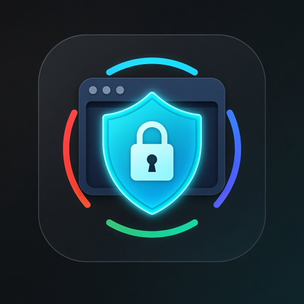

# BrowserShield

BrowserShield checks a website's security setup one browser at a time. It covers security headers, HTTPS, cookies and compatibility, flags gaps and suggests fixes for Chrome, Safari, Firefox, Edge and mobile. Free and MIT-licensed, with no paid services.

## Project status: done, pending, uncertain
**Done**
- 2026-10-15: v1.0.6 merges the pillars into one section in Rob's words (rule file and README).
- 2026-10-15: full re-test PASS (manifest, frontmatter, file links, JSON/CSV export columns, two-fetch passive audit of our own repo page).
- 2026-10-14: per-browser notes for Permissions-Policy and X-Frame-Options checked against MDN.

**Pending**
- The plain-http to https redirect check was never verified, because port 80 is blocked from the build machine. It needs a test from a network where port 80 is reachable.
- Per-browser notes were checked against MDN for only two headers; the rest are pending.
- security.txt row in the sample is SINGLE-CHECK (one fetch).
- Marketplace review: submitted 2026-10-14, pending, no approval yet.

**Uncertain**
- How the listing works on the Grok Bot and Grok side: not described in the Cursor publisher terms, so not confirmed.
- Whether xAI review will require changes: unknown until review.

## Quick start
1. Install (see Installation).
2. Ask: "Run BrowserShield on https://your-site.example" (a site you own or may test).
3. Get a findings table with two checks each, per-browser notes, server snippets, and optional JSON or CSV export.

## Credits
- Inventor and publisher: Rob Domaine / Omnipotent Media LLC
- Builder: Jenny Echo

## Rob Domaine's four pillars
1. Trustworthy, honest, real data, truthful: never invent; anything unchecked is marked UNVERIFIED.
2. Use only legitimate means: legitimate, proven sources and methods; unreliable sources rejected.
3. Double-check everything: every finding is confirmed by two independent checks, and the report shows both.
4. Stay within the law and rules always: local, county, state, federal and platform rules.

## Legal and scope
Only test sites you own or have written permission to test. Unauthorized testing can violate laws such as the U.S. CFAA. BrowserShield is a passive configuration review, not a penetration test, and never stores cookie values. Not legal advice.

## Components
- `skills/audit-browser-security`: passive audit of headers (CSP, HSTS, framing, Referrer-Policy, Permissions-Policy, COOP/COEP, nosniff), HTTPS and TLS, cookie flags, mixed content, with per-browser notes.
- `skills/write-fix-snippets`: nginx, Apache, Caddy, Netlify, Vercel and Express snippets.
- `rules/pillars-and-scope.mdc`: authorization, passive-only scope and the pillars.
- `examples/sample-report.md`: a real run on our own GitHub repo page.

## Requirements
curl and openssl. No paid APIs, no Google or Facebook services.

## Installation
Copy to `~/.cursor/plugins/local/browsershield/`, or install from the marketplace once listed.

## Feedback and reviews
- Reviews and feedback: [Discussions](https://github.com/OmnipotentCEOxJenny/browsershield/discussions)
- [Report a wrong finding](https://github.com/OmnipotentCEOxJenny/browsershield/issues/new?template=wrong-finding.md)
- [Feature request](https://github.com/OmnipotentCEOxJenny/browsershield/issues/new?template=feature-request.md)

License: MIT.
